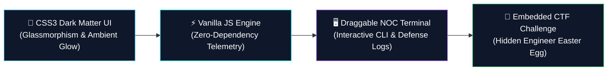

<div align="center">

# 🌐 Mustaquim Ahmad | IT Strategy & Operations

### **Architecting Intelligent Digital Resilience.**

[](https://mustaquim-ms.github.io/)
[](https://www.linkedin.com/in/mustaquimahmad/)
[](https://medium.com/@mustaquim)
[](https://zenodo.org/records/18813175)

<p>
  <a href="#-executive-summary">Executive Summary</a> •
  <a href="#-core-impact-pillars">Impact Pillars</a> •
  <a href="#-technical-arsenal">Technical Arsenal</a> •
  <a href="#-published-research-aiops">AIOps Research</a> •
  <a href="#-portfolio-architecture">Portfolio Architecture</a> •
  <a href="#-initiate-connection">Connect</a>
</p>

</div>

---

## 🚀 Executive Summary

I am a results-driven **Systems Engineer and IT Strategist** with **8+ years of experience** bridging the gap between traditional enterprise IT operations and intelligent automation.

My core philosophy is moving organizations beyond reactive firefighting toward **proactive digital resilience**. I specialize in transforming fragmented technology stacks into streamlined, Zero-Trust, and self-healing business engines powered by AIOps telemetry and enterprise-scale endpoint automation.

> _"I don't just manage infrastructure; I engineer it to move at the speed of business."_

---

## 🎯 Core Impact Pillars

| Strategic Pillar           | Operational Shift                                                                                            | Business Outcome                                                                |
| :------------------------- | :----------------------------------------------------------------------------------------------------------- | :------------------------------------------------------------------------------ |
| **🛡️ Zero-Trust Security** | Perimeter-only defense $\rightarrow$ Identity-first & micro-segmented access (`Entra ID`, `MFA`, `Fortinet`) | Eliminates lateral movement risks and enforces continuous device compliance     |
| **🤖 AIOps & Telemetry**   | Reactive ticket triage $\rightarrow$ Predictive anomaly detection & automated self-healing scripts           | Cuts Mean Time to Resolution (**MTTR**) and prevents silent service degradation |
| **☁️ Modern Endpoint Ops** | Manual imaging & desk-side visits $\rightarrow$ Zero-touch cloud provisioning (`Intune` + `Autopilot`)       | Scales onboarding across distributed teams with consistent policy baselines     |
| **📊 ITIL v4 Governance**  | Ad-hoc firefighting $\rightarrow$ SLA-driven change management & full asset lifecycle tracking               | Aligns IT spend with measurable uptime and executive KPIs                       |

---

## 🛠️ Technical Arsenal

| Domain                             | Technologies, Platforms & Methodologies                                                                             |
| :--------------------------------- | :------------------------------------------------------------------------------------------------------------------ |
| **☁️ Cloud & Endpoint Management** | Microsoft Entra ID (Azure AD), Microsoft Intune, Windows Autopilot, SCCM / MECM, Windows Server (AD, DNS, DHCP)     |
| **🔒 Networking & Security**       | Zero-Trust Architecture, Cisco Routing & Switching, Cisco Meraki, Fortinet FortiGate, VLANs, Site-to-Site VPNs, MFA |
| **⚡ Automation & Scripting**      | Python, PowerShell, Bash, Microsoft Power Automate                                                                  |
| **📡 Monitoring & Telemetry**      | PRTG, MRTG, Wireshark, Azure Log Analytics, AIOps Anomaly Detection                                                 |
| **📋 Operations & ITSM**           | ITIL v4 Framework, ServiceNow, Change Management, SLA Optimization, Asset Lifecycle Management                      |

---

## 🔬 Published Research (AIOps)

I actively research and publish peer-reviewed methodologies for applying Machine Learning and signal analysis to enterprise infrastructure monitoring:

| Publication Title                                                                                                                | Core Focus                                                                                  | Repository               |
| :------------------------------------------------------------------------------------------------------------------------------- | :------------------------------------------------------------------------------------------ | :----------------------- |
| **[Automated Anomaly Detection in Cloud Microservices Using LSTM Autoencoders](https://zenodo.org/records/18813175)**            | Deep-learning sequence modeling to flag multi-metric cloud drift before SLA breaches        | Zenodo _(Peer Reviewed)_ |
| **[Unsupervised Anomaly Detection in Microservice Telemetry: Identifying Silent Failures](https://zenodo.org/records/18477902)** | Unsupervised ML pipelines designed to uncover non-crashing "silent" service degradation     | Zenodo _(Peer Reviewed)_ |
| **[Leveraging Acoustic Side-Channel Analysis for Predictive Hardware Maintenance](https://doi.org/10.5281/zenodo.19229515)**     | Non-invasive acoustic telemetry to detect physical fan, drive, and server degradation early | Zenodo _(Peer Reviewed)_ |

---

## 💻 Portfolio Architecture

This repository houses the source code for my live interactive portfolio ([mustaquim-ms.github.io](https://mustaquim-ms.github.io/)). Reflecting my engineering philosophy of **minimal attack surface and maximum performance**, the site is built from the ground up with **zero external framework bloat**.



### ✨ Engineered Highlights

- 🌌 **Ultra-Premium "Dark Matter" Aesthetic:** Custom CSS variables, dynamic glassmorphism (`backdrop-filter`), and CSS-drawn ambient lighting.
- ⚡ **Zero-Dependency Animations:** Interactive telemetry nodes, sticky project stacking, and SVG circular progress indicators built purely in Vanilla JavaScript and CSS3.
- 🖥️ **"System OS" NOC Experience:** Includes a fully draggable terminal overlay and simulated active-defense event logs modeled after a real Network Operations Center.
- 🚩 **Interactive CTF Easter Egg:** Features a hidden Capture The Flag challenge for fellow engineers to uncover directly through the UI terminal.

### 🚀 Local Setup

No `npm`, `yarn`, or build steps required—just clone and launch:

```bash
# 1. Clone the repository
git clone https://github.com/mustaquim-ms/portfolio.git
cd portfolio

# 2. Launch directly in your default browser
open index.html        # macOS
# start index.html     # Windows
# xdg-open index.html  # Linux
```

---

## 📬 Initiate Connection

Whether you are looking to overhaul enterprise infrastructure, migrate to modern zero-touch endpoint management, or implement Zero-Trust security, let's connect.

```bash
➜  ~ contact --protocol secure-channel

[OK] Resolving endpoints for Mustaquim Ahmad...
  ├── 🌐 Portfolio : https://mustaquim-ms.github.io/
  ├── 📧 Email     : mustaquimmahmad@gmail.com
  ├── 💼 LinkedIn  : https://www.linkedin.com/in/mustaquimahmad/
  ├── ✍️  Medium    : https://medium.com/@mustaquim
  └── 🐙 GitHub    : @mustaquim-ms
```
